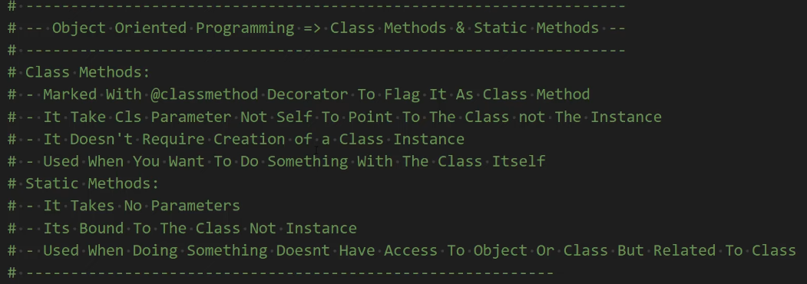

## Detailed Code Explanation — ft_garden_analytics.py

### Line 1-8: `Plant` class
- `__init__` creates the object with `name`, `height`, `age`
- `self` = the current plant object (like "this" in other languages)
- `grow()` uses `self.height += 1` → changes ONLY that plant's height

### Line 11-15: `FloweringPlant(Plant)` — inheritance
- Inherits everything from `Plant` (name, height, grow)
- Adds `color` and `blooming` with `super().__init__()` (calls parent constructor)

### Line 18-21: `PrizeFlower(FloweringPlant)` — inheritance chain
- Inherits from `FloweringPlant` → gets `color`, `blooming`, `grow`
- Adds `prize` (points)

### Line 24-70: `Garden` class
- `self.plants = []` holds all plants for this garden
- `add_plant()` = instance method (needs `self` to know WHICH garden)
- `help_all_plants_grow()` = loops through `self.plants` and calls `grow()` on each
- `report()` = builds a string describing all plants in this garden

### Line 73-75: `utility_no_garden_data()` — regular function
- Not inside any class
- Doesn't need `self` or garden data
- Just returns a string

### Line 78-143: `GardenManager` — handles MULTIPLE gardens
- `__init__`: creates `self.gardens = []` (empty list to store gardens)
- `add_garden()`: instance method — uses `self.gardens` (needs `self`)
- `get_total_gardens()`: instance method — uses `self.gardens`
- `get_all_plants()`: loops over all gardens, gets all plants

### Line 99-130: `GardenStats` — NESTED helper class
- Lives INSIDE `GardenManager` (`GardenManager.GardenStats`)
- `@staticmethod` methods (`total_growth`, `average_height`, etc.)
- These DON'T use `self` — they receive a `garden` argument and calculate
- Example: `total_growth(garden)` sums heights, doesn't need instance data

### Line 132-138: `@classmethod` — `create_garden_network()`
- Takes `cls` (the class itself, not an instance)
- Creates a new `GardenManager` and fills it with empty gardens
- `cls()` creates a new instance of whatever class is calling it

### Line 140-143: `@staticmethod` — `validate_height()`
- Doesn't need `self` or `cls`
- Just checks if a number is positive
- Works independently of any manager instance

### Line 146-148: `calculate_plant_score()` — regular utility
- Takes `height` and `age`, calculates score
- Not tied to any class or instance

### Line 151-225: `main()` — demo
- Creates plants → creates gardens → creates manager
- Shows instance methods (`add_garden`), static methods (`validate_height`), nested stats (`GardenStats`), utility functions (`calculate_plant_score`)

---

## When do you use @staticmethod?

| Situation | Use this |
|---|---|
| Need `self.name` / instance data | Regular method (`def method(self)`) |
| Need `cls()` / create instances | `@classmethod` (`def method(cls)`) |
| Just a helper, no `self` or `cls` needed | `@staticmethod` (`def method(x)`) |
| Doesn't relate to class at all | Regular function outside |

**Hints:**
- If the method only takes plain arguments (numbers, lists, strings) and calculates something → likely `@staticmethod`
- If it needs to access `self.gardens` → regular instance method
- If it needs to call `GardenManager()` to create new objects → `@classmethod`

## @staticmethod — What is it?

A `@staticmethod` is a method that belongs to the **class**, but it does **NOT** receive `self` (no instance) or `cls` (no class). It behaves like a regular function that lives inside the class for organization.

### When to use it?

- When the method does **NOT** need to access any instance data (`self`)
- When the method does **NOT** need to access any class data (`cls`)
- When it's a **utility** or **helper** related to the class but independent of any object

### Example from our code (ft_garden_analytics.py):

```python
class GardenStats:
    @staticmethod
    def total_growth(garden):
        return sum(plant.height for plant in garden.plants)
```

**Why?** `total_growth()` takes a `garden` as an argument instead of using `self`. It doesn't need to know which `GardenManager` instance is calling it. It just calculates a number.

### Another example: `validate_height()`

```python
class GardenManager:
    @staticmethod
    def validate_height(height):
        return isinstance(height, (int, float)) and height > 0
```

**Why?** `validate_height` checks a number. It doesn't need `self.gardens` or any instance info. It works the same for every manager.

### When NOT to use it?

- If you need `self.name` or `self.height` → use regular method (`self`)
- If you need to create new instances or access class variables → use `@classmethod` (`cls`)
- If it doesn't relate to the class at all → just make a regular function outside

**Why:** Keeps logic organized but independent. Like putting a calculator inside a toolbox — it works the same whether you grab toolbox #1 or toolbox #2.
